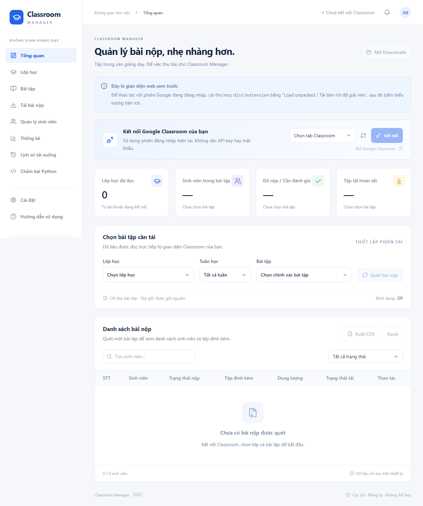

# Classroom Manager

Ứng dụng tiếng Việt để đọc lớp, bài tập và bài nộp từ **giao diện Google Classroom trong hồ sơ Chrome/Edge hiện tại**, sau đó yêu cầu Google Drive tải từng tệp gốc. Giao diện React được đóng gói trong tiện ích Manifest V3; người dùng cuối không cần Node, Python, localhost, API key hoặc Google Cloud Project.

**Trạng thái:** MVP có mã nguồn, bản build và kiểm thử trên trang mô phỏng. Chưa kiểm chứng adapter trên một tài khoản Classroom thực tế. Không bảo đảm mọi phiên bản DOM của Google đều được nhận diện. Khi không xác minh được dữ liệu, tiện ích báo lỗi và không tải dựa trên suy đoán.

## Dùng bản đã build

1. Giải nén `release/Classroom-Manager-1.0.1.zip`.
2. Mở `chrome://extensions` hoặc `edge://extensions`.
3. Bật **Chế độ nhà phát triển** → **Tải tiện ích đã giải nén / Load unpacked**.
4. Chọn thư mục **Classroom-Manager** có tệp `manifest.json`.
5. Mở Google Classroom, chọn tài khoản giáo viên, về trang chủ có danh sách lớp.
6. Bấm biểu tượng Classroom Manager → làm mới tab → chọn tab → **Kết nối**.
7. Chọn lớp, bài tập cụ thể → **Quét bài nộp** → kiểm tra số lượng/cảnh báo → **Tải tất cả bài nộp**.

Cũng có thể cài trực tiếp thư mục `dist/extension`. Không mở `index.html` bằng File Explorer để sử dụng phiên Classroom. Bản web độc lập chỉ cho xem giao diện và hướng dẫn cài tiện ích.



## Chức năng MVP

- Chọn tab Classroom, đọc tài khoản đang hoạt động, danh sách lớp và bài tập từ DOM.
- Nhận diện tuần 1–15; bài ngoài tuần được chọn trực tiếp theo định danh, không tự chọn khi trùng tên.
- Xác minh tab Bài tập của học viên và liên kết sinh viên thuộc đúng lớp/bài tập trước khi tải.
- Phân loại trạng thái Việt/Anh, lưu riêng trạng thái không xác định, đối chiếu bộ đếm.
- Thu thập các vùng cuộn có thể nhận diện, chờ MutationObserver với giới hạn thời gian.
- Tải tuần tự nhiều tệp của từng bài đã nộp; mặc định ZIP. Có cấu hình RAR, 7Z, PY, IPYNB, PDF, DOCX, XLSX, PPTX.
- Chỉ lấy đính kèm trong vùng bài làm đã xác minh thuộc sinh viên; bỏ vùng tài liệu giảng viên.
- Một tab làm việc trong hàng đợi; tạm dừng, tiếp tục, dừng, thử lại lỗi.
- Chỉ xác nhận hoàn tất bằng Downloads API; phát hiện MIME HTML, gián đoạn và lỗi quyền.
- Tên tệp an toàn cho Windows, đường dẫn tương đối trong Downloads, `uniquify` chống ghi đè.
- Chrome Storage lưu phiên, cấu hình, lịch sử; phục hồi về trạng thái tạm dừng sau khi worker bị ngắt.
- Chỉ bỏ qua bài trùng khi có định danh + phiên bản đã tải thành công. Không có phiên bản thì tải lại.
- Xuất CSV UTF-8 BOM, Excel `.xlsx`, nhật ký JSON có tùy chọn ẩn thông tin cá nhân; tự xuất CSV tổng kết cuối phiên.
- Module chấm Python mới có hợp đồng tích hợp, chưa thực thi mã.

## Mã nguồn và phát triển

Yêu cầu dành riêng cho lập trình viên: Node 22.12+ hoặc Node 24, npm.

```powershell
npm ci
npm test
npm run build
npm run test:e2e
npm run package
```

Playwright cần Chromium. Nếu máy chưa có, chạy `npx playwright install chromium`. Có thể đặt `CM_CHROMIUM_PATH` trỏ đến Chromium hỗ trợ sideload extension. Bản Chrome thương mại mới có thể chặn cờ nạp extension trong automation; dùng Chromium của Playwright cho E2E.

```text
apps/web/                   React + TypeScript, CSS + Tailwind, Lucide
apps/extension/             manifest, content script, service worker
packages/browser-adapter/   điều hướng, timeout, retry khóa tab
packages/classroom-adapter/ DOM, account, course, assignment, student, attachment
packages/drive-adapter/     tên tệp xem trước, nút tải Drive và kiểm tra mơ hồ
packages/submission-parser/ trạng thái, tuần, phần mở rộng, chữ ký ZIP
packages/download-manager/ hàng đợi, nhận dạng lượt tải, lịch sử
packages/storage/           Chrome Storage, schema v1
packages/shared/            types, tên tệp, CSV, báo cáo, chẩn đoán
packages/grading/           hợp đồng sandbox tương lai
tests/                     unit, integration, e2e và fixtures
scripts/                   build và đóng gói ZIP
docs/                      cài đặt, kiến trúc, kiểm thử, giới hạn
dist/extension/            bản cài được bằng Load unpacked
release/                   ZIP bản cài và mã nguồn
```

## Tài liệu

- [Cài đặt, sử dụng và cập nhật](docs/CAI-DAT.md)
- [Kiến trúc và quyền riêng tư](docs/KIEN-TRUC.md)
- [Báo cáo kiểm thử](docs/KIEM-THU.md)
- [Lỗi đã xử lý và giới hạn](docs/GIOI-HAN.md)

Không gửi dữ liệu sinh viên lên máy chủ; không đọc mật khẩu, cookie, token; không thay đổi điểm, trả bài hoặc gửi thông báo. Chỉ thao tác với dữ liệu giảng viên đang được phép xem.
