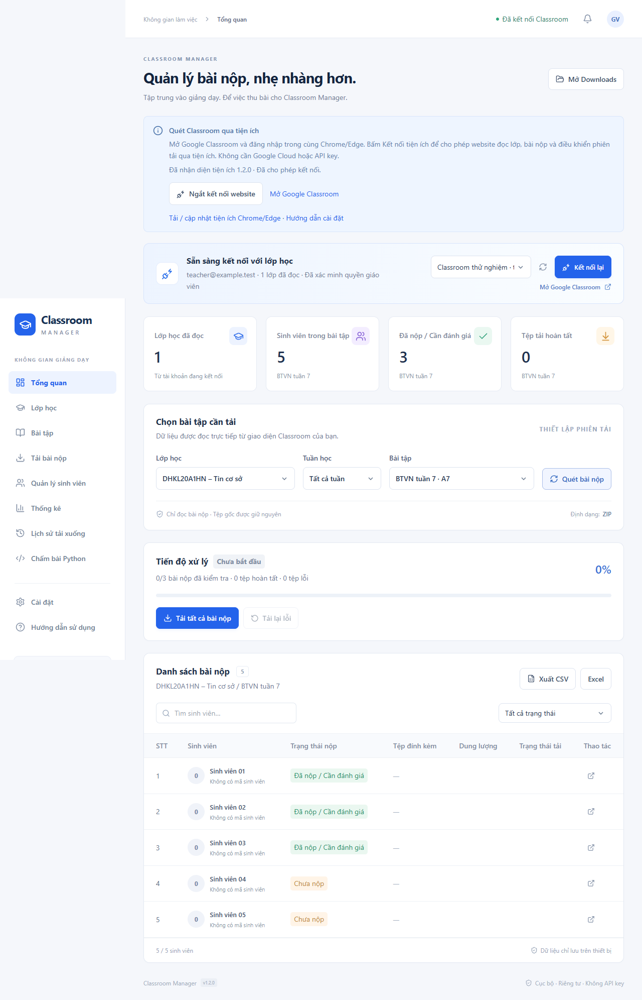

# Classroom Manager

Website tiếng Việt để xem lớp, bài tập, quét bài nộp và điều khiển tải tệp qua **tiện ích Chrome/Edge đã cài**. Đăng nhập tại Google Classroom như bình thường; dữ liệu được đọc từ giao diện Classroom rồi hiển thị trực tiếp trên website. Không cần Google Cloud, OAuth Client ID, Classroom API hoặc tải dữ liệu về để nhập lại.

- [Mở website](https://huando200666.github.io/classroom-manager/)
- [Tải tiện ích 1.2.0](https://github.com/huando200666/classroom-manager/releases/download/v1.2.0/Classroom-Manager-1.2.0.zip)
- [Mã nguồn và các bản phát hành](https://github.com/huando200666/classroom-manager/releases)

## Sử dụng

1. Nếu đã cài bản cũ: dừng phiên tải, giải nén bản 1.2.0 **đè vào đúng thư mục tiện ích cũ**, vào `chrome://extensions` hoặc `edge://extensions` và bấm **Tải lại / Reload**. Giữ nguyên thư mục để giữ định danh và dữ liệu tiện ích. Cài lần đầu: bật Developer mode, chọn Load unpacked và thư mục `Classroom-Manager` có `manifest.json`.
2. Mở [Google Classroom](https://classroom.google.com/), đăng nhập đúng tài khoản trong cùng hồ sơ Chrome/Edge và về trang danh sách lớp.
3. Mở hoặc nhấn F5 tại [website](https://huando200666.github.io/classroom-manager/), bấm **Kết nối tiện ích**. Một tab Classroom sẽ được kết nối tự động; nếu có nhiều tab, chọn tab mong muốn rồi bấm Kết nối.
4. Chọn lớp → bài tập → **Quét bài nộp**. Kiểm tra số lượng, trạng thái và cảnh báo trước khi tải.
5. Bấm **Tải tất cả bài nộp** nếu cần. Có thể tạm dừng, tiếp tục, dừng, thử lại lỗi và xuất CSV/Excel.

Tiện ích tạm hiển thị Classroom khi đọc để tránh tab nền làm chậm bộ đọc. Quyền giáo viên được kiểm tra khi quét bài nộp. Website và Classroom phải mở trong cùng trình duyệt/hồ sơ có tiện ích. Mở `index.html` từ File Explorer hoặc chạy localhost không cung cấp cầu nối tới dữ liệu thật.

**Ngắt kết nối website** xóa dữ liệu hiển thị và quyền kết nối của tab đó. Không xóa lịch sử trong tiện ích, không xóa tệp đã tải và không dừng hàng đợi đang chạy. Muốn dừng tải, bấm Dừng trước khi ngắt. Tải lại website cần bấm kết nối lại. Có thể dùng dashboard riêng bằng biểu tượng tiện ích.



## Chức năng

- Đọc tài khoản, lớp, bài tập và danh sách bài nộp từ DOM Classroom; phân loại trạng thái Việt/Anh và đối chiếu bộ đếm.
- Chọn tuần 1–15 hoặc bài tập cụ thể; phân biệt bài trùng tên bằng định danh.
- Tải tuần tự nhiều tệp của mỗi bài nộp; mặc định ZIP, có cấu hình thêm định dạng.
- Chỉ đọc tệp trong vùng bài làm đã xác minh; bỏ tài liệu đề bài của giáo viên.
- Xác nhận hoàn tất qua Chrome Downloads, kiểm tra MIME/kích thước, ghi lỗi và thử lại riêng.
- Tên tệp phù hợp Windows, chống ghi đè, lịch sử theo tài khoản và phiên bản tệp khi có.
- CSV UTF-8 BOM, Excel và nhật ký JSON có tùy chọn ẩn thông tin cá nhân.
- Chấm Python mới có hợp đồng tích hợp, chưa chạy mã sinh viên.

## Quyền riêng tư và giới hạn

Website chỉ kết nối sau khi bạn bấm nút cho phép. Cầu nối giới hạn ở trang chủ của dự án trên GitHub Pages, main frame và từng tài liệu/tab; không tự mở dữ liệu khi chỉ truy cập website. Các lệnh tải/cài đặt cần thao tác bấm trực tiếp. Dữ liệu tài khoản khác bị lọc khỏi kết quả website.

Website giữ dữ liệu trong RAM; tiện ích lưu cấu hình, phiên và lịch sử bằng Chrome Storage local, lưu quyền kết nối bằng storage session. Không gửi dữ liệu lớp lên GitHub hoặc backend riêng, không đọc mật khẩu/cookie/token Google, không sửa điểm hay trả bài. Xem [chính sách riêng tư](https://huando200666.github.io/classroom-manager/privacy.html).

**Adapter phụ thuộc giao diện Classroom/Drive.** Người dùng đã xác nhận đọc được danh sách lớp khi hiển thị Classroom; luồng bài nộp/tải trên tài khoản thật vẫn cần đối chiếu. Kiểm thử tự động dùng DOM mô phỏng và tiện ích MV3 thật, không chứng minh mọi bố cục Google đều được hỗ trợ. Xem [giới hạn](docs/GIOI-HAN.md).

## Phát triển và kiểm thử

Yêu cầu Node 22.12+ hoặc Node 24 và npm.

```powershell
npm ci
npm test
npm run build
npm run build:web
npm run test:e2e
npm run package
```

Playwright cần Chromium hỗ trợ sideload extension (`npx playwright install chromium` hoặc `CM_CHROMIUM_PATH`). Test cầu nối phục vụ `dist/site` ở origin production mô phỏng, nên phải build cả tiện ích và web trước E2E. Dev localhost chỉ xem giao diện; không có cầu nối được cấp quyền.

GitHub Actions chạy unit/integration, build `dist/site` rồi triển khai Pages khi đẩy `main`. Bản cài nằm ở `dist/extension`; `release` chứa ZIP tiện ích, ZIP mã nguồn và SHA-256. Không đưa `node_modules` hay hồ sơ kiểm thử vào Git.

```text
apps/web/                   Dashboard React và client cầu nối website
apps/extension/             Manifest, background, Classroom/Drive và website content scripts
packages/web-bridge/        Giới hạn website, lệnh và lọc trạng thái theo tài khoản
packages/browser-adapter/   Điều hướng, timeout, retry khóa tab
packages/classroom-adapter/ Bộ đọc DOM tài khoản/lớp/bài tập/bài nộp
packages/drive-adapter/     Nhận diện tệp và nút tải trên Drive
packages/download-manager/ Hàng đợi, xác minh lượt tải, lịch sử
packages/shared/            Types, parser báo cáo, tên tệp
tests/                     Unit, integration, E2E và fixtures
docs/                      Hướng dẫn, kiến trúc, kiểm thử, giới hạn
public/                    Trang quyền riêng tư
```

- [Cài đặt và cập nhật](docs/CAI-DAT.md)
- [Kiến trúc](docs/KIEN-TRUC.md)
- [Báo cáo kiểm thử](docs/KIEM-THU.md)
- [Thay đổi 1.2.0](docs/PHAT-HANH-1.2.0.md)
