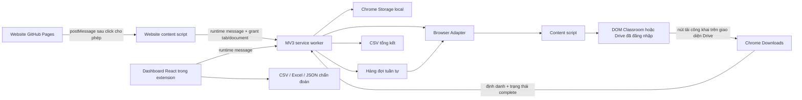

# Kiến trúc Classroom Manager

## Website qua tiện ích từ 1.2.0

Website và dashboard tiện ích dùng chung `App`. Bản web dùng `apps/web/bridge.ts` gửi thông điệp có mã yêu cầu qua `window.postMessage` cho `website.ts` trong isolated world. Content script chuyển lệnh bằng `chrome.runtime.sendMessage` vào service worker. Website không cần biết extension ID và không dùng `externally_connectable`; bản unpacked giữ định danh khi cập nhật cùng thư mục.

Chỉ main frame tại `https://huando200666.github.io/classroom-manager/` hoặc `index.html` được cấp quyền. Probe chỉ trả phiên bản tiện ích, không trả trạng thái riêng tư. Content script cấp quyền khi nhận click `isTrusted` vào nút Kết nối tiện ích; lệnh authorize do script trang tự gửi không được chấp nhận. Các lệnh tải/cài đặt cần click trực tiếp tương ứng và được dùng một lần trong 5 giây. Background kiểm tra extension ID, URL nguồn/tab, frame và document ID, rồi đối chiếu grant trong `chrome.storage.session`. Mỗi lần cấp lại tạo nonce mới; đóng tab thu hồi grant, tải lại tài liệu cần cấp lại.

Grant chỉ gắn với tài khoản sau khi đọc thành công từ tab Classroom được chọn. Trạng thái trước đó rỗng; history/run khác tài khoản bị lọc. Các lệnh điều khiển phiên tải phải khớp tài khoản của run. Thao tác thu hồi xử lý ngoài hàng đợi DOM dài; background kiểm tra lại nonce và content script kiểm tra epoch trước khi trả dữ liệu để chặn phản hồi tới muộn. Website xóa bộ nhớ hiển thị khi ngắt, không xóa Chrome Storage local và không dừng hàng đợi đang chạy. Website không được gọi lệnh clear toàn bộ dữ liệu.

Không có OAuth token hoặc Google API trong bản hiện tại. Website giữ dữ liệu trong RAM, không ghi localStorage/cookie và không gửi dữ liệu lớp tới backend riêng. GitHub Pages chỉ phục vụ tệp tĩnh. Các event storage tới website chỉ là tín hiệu thay đổi, không chứa raw dữ liệu; website phải yêu cầu trạng thái qua kiểm tra quyền.

## Luồng dữ liệu

Dashboard extension dùng runtime trực tiếp. Website được kết nối qua cầu nối giới hạn ở URL dự án. Bản `npm run dev` sử dụng cùng giao diện nhưng không thuộc URL được cấp quyền; không có dữ liệu minh họa tự sinh.

## Ranh giới và mô-đun

- `BrowserAdapter` cung cấp liệt kê tab, mở Classroom, điều hướng, tab làm việc và thông điệp DOM. `ChromiumAdapter` dùng API chính thức. Firefox cần implementation riêng và kiểm thử tương thích.
- Từ 1.0.3, các lệnh `courses`, `assignments`, `students` tạm kích hoạt tab Classroom trước khi đọc. Kết quả hoặc lỗi được giữ nguyên; tab trước đó được khôi phục nếu người dùng chưa tự chuyển sang tab khác. Không đổi tab cho lệnh tải Drive. Cách này xử lý trường hợp người dùng xác nhận đọc được khi hiển thị Classroom nhưng bị timeout khi để ở nền. Chrome có thể trì hoãn timer của tab nền: [tài liệu Chrome](https://developer.chrome.com/blog/timer-throttling-in-chrome-88).
- Từ 1.2.1, kích hoạt Classroom ngay trong điều hướng/chờ tài liệu và lệnh `studentWork`. Không tải lại URL tab vừa bắt đầu mở. Bộ chờ xác minh ping có URL đúng đích dù trạng thái tab còn loading, không chỉ chờ complete; mỗi ping có ngân sách nằm trong tổng 22 giây. URL Classroom cho phép phần tài khoản được thêm và chế độ details/submissions của cùng bài, không gộp trang học viên; kiểm tra tài khoản/quyền từ DOM vẫn bắt buộc.
- Content script chạy trong isolated world, đọc DOM công khai, ARIA, title, href, text và data attributes có trên trang. Không đọc dữ liệu bootstrap nội bộ, storage Google, cookie hay token.
- Parser dùng các nhóm trạng thái Việt/Anh, ưu tiên phủ định để không đọc “Not submitted” thành “Submitted”. Trạng thái mâu thuẫn là unknown.
- Bộ thu thập động dùng MutationObserver để đợi dữ liệu và quét các vùng cuộn có thể nhận diện. Có giới hạn tổng thời gian, đối chiếu bộ đếm và không khẳng định đã quét đủ nếu thiếu.
- Tệp phải có liên kết Drive đã hiện diện trong vùng bài nộp đã xác minh cho đúng sinh viên. Không suy ra bài nộp từ thư mục Drive.
- Mọi thay đổi trạng thái background đi qua hàng thao tác tuần tự để tránh ghi đè storage bởi các sự kiện downloads đồng thời.

## Vòng đời hàng đợi

Sinh viên đủ điều kiện → đọc vùng bài làm → lọc phần mở rộng → tạo FileTask → điều hướng tới liên kết Drive quan sát được → bấm nút Download/Tải xuống → chờ Chrome tạo lượt tải có cùng file ID → gợi ý tên bằng onDeterminingFilename → theo dõi trạng thái.

Chỉ một FileTask `starting/downloading` tồn tại trong tiến trình bình thường. Mỗi bước ghi storage trước khi thao tác có tác dụng phụ. Không tự bấm lại tải khi kết quả không rõ. Tab thao tác được tái sử dụng xuyên suốt phiên tải; tab tạm đọc danh sách bài tập được đóng sau khi đọc.

`chrome.alarms` đánh thức worker định kỳ 30 giây. `downloads.onCreated`, `onDeterminingFilename` và `onChanged` liên kết/đối chiếu lượt tải; trong khi hàng đợi hoạt động, cơ chế dự phòng kiểm tra lịch sử Downloads mỗi giây nếu còn tệp chờ xác nhận. Chỉ liên kết khi định danh tệp và mốc thời gian khớp; không liên kết bằng tên đơn thuần. Sau khi service worker bị dừng/restart, phiên đang chạy được chuyển về paused; tác vụ `starting` chưa có download ID được ghi thất bại có nguyên nhân để người dùng kiểm tra trước khi thử lại. Lượt có download ID được đối chiếu lại bằng downloads.search.

Tạm dừng/dừng được áp dụng sau thao tác DOM hiện tại có giới hạn timeout; không cắt ngang việc đọc DOM tức thì. Lượt đang tải khi pause được phép hoàn tất. Stop hủy lượt đã liên kết chưa xong.

## Xác nhận lượt tải và định dạng

Không coi trùng tên là đủ bằng chứng. File ID phải khớp một thành phần đường dẫn/query trong URL tải hoặc referrer đầy đủ cùng tên tệp, trên miền Drive/googleusercontent hợp lệ và sau thời điểm yêu cầu tải. Không ghép được thì báo lỗi; tệp có thể vẫn xuất hiện trong Downloads mặc định và cần người dùng kiểm tra.

Khi `state=complete`, kiểm tra MIME và kích thước do trình duyệt cung cấp trước khi ghi thành công. HTML không được xác nhận thành ZIP. Việc tải không đọc/giải nén nội dung và không tự chấp nhận file nguy hiểm.

API downloads không cấp quyền đọc byte tùy ý từ ổ đĩa. Hàm kiểm tra chữ ký ZIP có unit test để dùng khi có nguồn byte hợp lệ, nhưng luồng production hiện không kiểm tra chữ ký; thông tin này được ghi trong báo cáo từng tệp.

## Dữ liệu, chống trùng và báo cáo

Chrome Storage local lưu schema 1, tài khoản từ DOM, lớp/bài tập, phiên hiện tại, cấu hình, lịch sử và 300 nhật ký gần nhất. Không dùng sync storage. Lịch sử có tài khoản, lớp, bài tập, tuần, sinh viên, file ID, revision nếu DOM có, trạng thái, thời gian và download ID.

Khóa chống trùng gồm account/course/assignment/student/file ID/revision. Chỉ bỏ qua nếu có revision không rỗng và lịch sử complete cùng khóa. Khi không có revision, tải lại để không bỏ sót nội dung sửa cùng file ID.

CSV có UTF-8 BOM, quote escaping và chống công thức khi ô bắt đầu bằng ký tự đặc biệt. Excel xuất các chuỗi bằng ExcelJS, không xây công thức từ dữ liệu người dùng. Báo cáo bao gồm toàn bộ sinh viên, kể cả missing/unknown/không có file và lỗi. Nhật ký chẩn đoán mặc định thay danh tính, bỏ URL và thông tin file.

## Quyền và bảo mật

Chỉ `storage`, `downloads`, `alarms`, `scripting` và host permissions Classroom/Drive/`huando200666.github.io`. Quyền host website có độ rộng theo origin của Chrome; content script và background giới hạn thêm đúng đường dẫn dự án. Quyền scripting nạp lại duy nhất tệp `content.js` đóng gói sẵn vào main frame Classroom/Drive khi Chrome báo tab chưa có bộ nhận. Không tải lại trang của giảng viên, không chạy mã lấy từ mạng. Không xin `cookies`, `identity`, `debugger`, `<all_urls>`, quyền native messaging hay quyền đọc toàn bộ tab không liên quan.

Từ 1.0.1, lỗi không có bộ nhận được phục hồi bằng scripting.executeScript trong isolated world và gửi lại lệnh đúng một lần. Nếu cổng đóng giữa chừng, không tự phát lại lệnh vì có thể thao tác tải đã được thực hiện. Script tự thay bộ nhận cũ khi nạp lại để không bấm tải trùng. Lỗi dashboard đã bị vô hiệu hóa sau cập nhật được đổi thành hướng dẫn đóng trang và mở lại từ biểu tượng tiện ích.

Background nhận `cm-app` từ extension page cùng ID và `cm-web` từ website content script đã kiểm tra nguồn/grant. Content script Classroom/Drive chỉ nhận lệnh cùng extension ID. Không có externally_connectable hoặc tải mã từ xa. CSP extension chỉ cho script nội bộ, React escape text mặc định. Không thao tác chấm điểm, trả bài, xóa hoặc thông báo sinh viên.

## Tích hợp chấm Python tương lai

`packages/grading/contract.ts` khai báo GradingSandbox. Chưa có implementation. Worker chấm phải là môi trường độc lập có giới hạn CPU/RAM, network=false và không nhận cookie, token hay Chrome profile. Không chạy mã sinh viên trong extension.

## Phương án API trong tương lai

Các mục dưới đây là hướng tham khảo nếu sau này cần website chạy độc lập với tiện ích, chưa áp dụng cho bản 1.2.0. Bản OAuth/API thử nghiệm 1.1.0 đã được bỏ khỏi website hiện tại theo lựa chọn dùng tiện ích; mã cũ còn trong lịch sử Git. Có thể tái sử dụng dashboard và mô hình bài nộp, nhưng phải thay tầng DOM/Chrome Downloads và xác minh quyền Google.

| Ưu tiên | Nâng cấp                                                                                                                            | Điều kiện kiểm thử trước khi sử dụng                                                                                                                       |
| ------- | ----------------------------------------------------------------------------------------------------------------------------------- | ---------------------------------------------------------------------------------------------------------------------------------------------------------- |
| 1       | Backend và đăng nhập Google OAuth; Classroom API đọc lớp, bài tập, danh sách học viên và bài nộp; Drive API tải nội dung            | Dùng lớp thật được cho phép; so khớp danh sách/trạng thái/tệp với Classroom; thử từ chối quyền, thu hồi quyền, hết phiên và tài khoản không phải giáo viên |
| 2       | Hàng đợi lưu trên server; phân trang API; retry có giới hạn cho lỗi tạm thời; khóa chống xử lý trùng                                | Ngắt mạng, khởi động lại worker và gửi lệnh trùng; kết quả không thiếu trang, không ghi nhận tải thành công khi tệp lỗi                                    |
| 3       | Tải thành ZIP chung theo lớp/bài tập, xử lý tên trùng; xuất Google Docs/Sheets/Slides theo định dạng phù hợp; xác minh nội dung tải | Nhiều tệp trên một bài nộp, trùng tên, file lớn, file thiếu quyền, tài liệu Google và ZIP hỏng; đối chiếu báo cáo với tệp thực                             |
| 4       | Nhiều giáo viên: tách dữ liệu theo tài khoản, kiểm tra quyền từng yêu cầu, quản lý phiên và lịch sử có phân trang                   | Hai tài khoản mở đồng thời; thay ID lớp/tệp trong request; người dùng chỉ truy cập dữ liệu họ được quyền xem                                               |

Luồng dự kiến: trình duyệt → backend có phiên đăng nhập → Classroom/Drive API → hàng đợi xử lý và kho kết quả tạm thời → trình duyệt tải kết quả. Cần xác định thời hạn giữ tệp và lịch sử; bảo vệ token trên backend; không đưa client secret vào mã giao diện.

Nếu chọn phương án API trong tương lai, cần Google Cloud Project, bật API, cấu hình OAuth cho địa chỉ website và kiểm chứng bằng tài khoản thử có quyền giáo viên. Việc xác minh ứng dụng và cho phép từ quản trị viên phụ thuộc phạm vi quyền và cách phát hành. Các yêu cầu này không áp dụng cho cầu nối tiện ích hiện tại.

Tham khảo: [quyền Classroom API](https://developers.google.com/workspace/classroom/guides/auth), [OAuth cho web server](https://developers.google.com/identity/protocols/oauth2/web-server), [tải và xuất tệp Drive](https://developers.google.com/workspace/drive/api/guides/manage-downloads).

## Tài liệu API chính thức của bản tiện ích

- https://developer.chrome.com/docs/extensions/reference/api/downloads
- https://developer.chrome.com/docs/extensions/develop/concepts/service-workers/lifecycle
- https://developer.chrome.com/docs/extensions/reference/api/alarms
- https://developer.chrome.com/docs/extensions/reference/api/storage
- https://vite.dev/guide/
